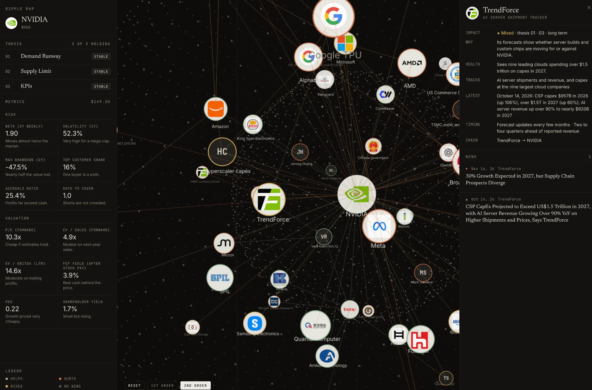

# Ripple

**Mosaic-theory research map for a single stock.**

Give Ripple an investment memo on a stock you own or short. It sends out a team of research agents and turns the memo into a live 3D map of every material supplier, customer, rival, regulator and owner one to three steps away, each scored against your thesis.


## Why

Investors build a view from many small public facts that mean little alone. A supplier's monthly sales, a customer's spending plans and a new export rule can tell you something together that none tells you separately. That is mosaic theory.

Ripple builds that mosaic automatically. It keeps second-order news, the things that never mention your stock but still move it, in one place, with every item dated and linked.

## Quick start

```bash
curl -fsSL https://raw.githubusercontent.com/robellephrm/ripple/main/install.sh | bash
```

Then type this in Claude Code or Prime Agent:

```text
/ripple path/to/memo.pdf
```

Or clone the repository and install from there:

```bash
git clone https://github.com/robellephrm/ripple.git
cd ripple
./install.sh
```

You need Node 20+, Python 3, git, and Claude Code or Prime Agent. macOS is tested. The installer copies the skill into `~/.claude/skills/ripple` and links it into Prime Agent when installed.

The first map opens a small app window and downloads Electron once, about 270 MB.

## Try the demo

The repo ships a finished run on NVIDIA, so you can see the app before you research anything yourself:

```bash
~/.claude/skills/ripple/scripts/new-workspace.sh nvidia-demo --example
~/.claude/skills/ripple/scripts/open-app.sh nvidia-demo
```

The demo memo is a sample written to show the tool. It is not a recommendation on NVIDIA. The news, filings and prices in it were real and dated when the run was made, so treat them as a snapshot.

## What you get

The left panel holds the memo's own thesis points. Each is rated **Strong / Stable / Weak / Broken** against the memo's own kill condition. Expand a point for **WHY**, **KILL**, **NEXT** and **NEWS**: the reasoning, what would break it, the next test and the evidence so far.

If the memo names KPIs, an optional KPI row brings in alternative data. Suppliers' monthly sales, input prices, hiring and consensus help show what moves those KPIs before the company reports.

You also get six risk and six valuation metrics chosen for that company from a researched library. No `n/a` entries or repeated measures filling space.

The 3D map puts your stock at the center. Green helps your position, red hurts it and gold is mixed, including when you are short. Click a thesis point to filter the map. Click a company for its card: impact, why it matters, financial health, the chain back to your stock and dated news with sources that open in your browser.



The map spins on its own, pauses while you read a card or drag, and resumes afterward. It always pivots around your stock.

## How it works

1. **Extract the thesis.** The thesis extractor reads the memo and preserves its actual reasons and kill conditions.
2. **Map the ecosystem.** Wave 1 scouts cover suppliers, the wider supply chain, buyers, demand, rivals and policy, including owners. Metrics and alternative-data scouts work alongside them.
3. **Go deeper.** Wave 2 sends a deep dive after each thesis point, following the relationships most likely to change the answer.
4. **Check the evidence.** Independent link checkers open every source and drop dead links or unsupported claims. Blocked sources and unconfirmed claims are reported.
5. **Judge and display.** A judge rates each thesis point against its kill condition. Ripple adds company logos, checks the data and opens the app.

Ripple runs with sub-agents in Claude Code, or as teams in a [Prime Fleet](https://github.com/robellephrm/prime-fleet). Fleet mode uses a different model family to cross-check load-bearing claims and Strong or Broken calls.

## Research sources

The research agents use the built-in free tool at `skills/ripple/app/scripts/research.mjs`, with no account needed, for Exa semantic search and news, SEC full-text search, Federal Register rules, and hiring data from public Greenhouse, Lever, and Ashby job boards. Exa's free tier is rate limited, and a free Exa API key in `EXA_API_KEY` raises that limit; page reads fall back to Exa and the Jina reader when a site blocks plain fetches. Firecrawl and other paid tools are optional extras, and running out of credits never stops a run.

## Honest notes

Research quality depends on public sources and the models reading them. A full run takes about an hour and a lot of web reads.

Ripple is a research tool, not investment advice.

The app runs locally in a sandboxed window with a strict content policy. Downloads are limited to public HTTPS addresses.

## Layout

```text
skills/ripple/
├── SKILL.md    # Research workflow
├── spec.md     # Product and design specification
├── agents/     # Specialist research instructions
├── app/        # 3D map and thesis panel
├── viewer/     # Electron app window
├── scripts/    # Workspace, data and launch tools
└── examples/   # The NVIDIA demo run
```

## License

MIT.
